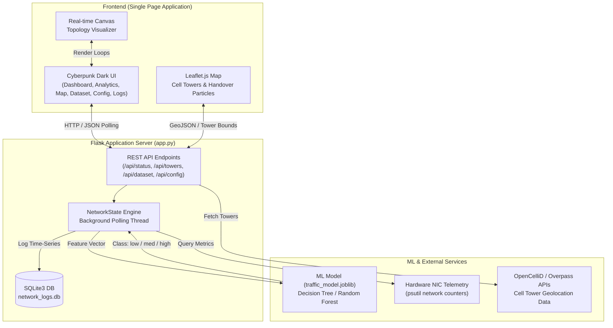

# 🌐 ML-Driven QoS Network Controller & Cell Tower Handover Simulator

[](https://www.python.org/)
[](https://flask.palletsprojects.com/)
[](https://scikit-learn.org/)
[](https://leafletjs.com/)
[](#)

An intelligent, full-stack Data Communication and Networks (DCN) platform that combines **Machine Learning-driven Quality of Service (QoS) traffic prioritization**, **real-time physical network telemetry**, **dynamic congestion control**, and an **interactive geospatial cellular tower handover simulator**.

---

## 📑 Table of Contents

- [Overview](#-overview)
- [System Architecture](#-system-architecture)
- [Key Features](#-key-features)
  - [1. ML-Powered QoS & Congestion Control](#1-ml-powered-qos--congestion-control)
  - [2. Real-Time Telemetry & NIC Monitoring](#2-real-time-telemetry--nic-monitoring)
  - [3. Cell Tower Handover Simulator](#3-cell-tower-handover-simulator)
  - [4. Cyber-Tech Single Page Application (SPA)](#4-cyber-tech-single-page-application-spa)
  - [5. Time-Series Telemetry Database & Seeding](#5-time-series-telemetry-database--seeding)
- [Project Structure](#-project-structure)
- [Machine Learning Pipeline](#-machine-learning-pipeline)
- [API Reference](#-api-reference)
- [Getting Started](#-getting-started)
  - [Prerequisites](#prerequisites)
  - [Installation](#installation)
  - [Environment Variables](#environment-variables)
  - [Running the Application](#running-the-application)
- [Cell Tower Handover Guide](#-cell-tower-handover-guide)
- [Configuration Options](#-configuration-options)
- [Tech Stack](#-tech-stack)

---

## 🌟 Overview

Modern telecommunication and computer networks experience rapid traffic fluctuations caused by streaming, web browsing, file transfers, and real-time voice calls. Traditional static QoS algorithms often fail during burst congestion, causing high latency and packet drops on mission-critical traffic.

This project delivers an **end-to-end adaptive network intelligence solution**:
1. **Monitors Live Hardware Interfaces**: Interrogates active network interface cards (NICs) using `psutil` to sample physical throughput, latency, queue depth, and arrival rates.
2. **Predicts Congestion with Machine Learning**: An optimized Decision Tree classifier predicts traffic congestion state (`low`, `med`, `high`) in real-time.
3. **Applies Dynamic QoS Prioritization**: Automatically shapes traffic, prioritizes VoIP/Real-Time streams, adjusts HTTP allocations, and throttles bulk FTP transfers during high congestion.
4. **Simulates Cellular Handovers Across Cities**: Visualizes live cell towers (GSM, UMTS, LTE, 5G NR) using OpenCelliD and OpenStreetMap Overpass APIs, simulating mobile subscriber handovers between geographic regions with animated telemetry flows.

---

## 🏗 System Architecture



---

## ✨ Key Features

### 1. ML-Powered QoS & Congestion Control
- **State Classification**: Real-time classification of network health into `low`, `med`, and `high` congestion states based on:
  - Total Bandwidth Load ($Mbps$)
  - Network Delay / Round-Trip Time ($ms$)
  - Internal Queue Occupancy (packets)
  - Packet Arrival Rate ($packets/s$)
- **Adaptive Bandwidth Allocation**:
  - **VoIP Guarantee**: Enforces strict minimum bandwidth reservations (e.g., 50%) during congestion bursts to prevent voice jitter and packet loss.
  - **Adaptive HTTP Shaping**: Scales standard web traffic to maintain responsive user experience.
  - **FTP Throttling**: Automatically lowers bulk transfer bandwidth during network stress and restores it when the network clears.

### 2. Real-Time Telemetry & NIC Monitoring
- Continuous hardware tracking using Python's `psutil` across active interfaces (Wi-Fi, Ethernet, Cellular data).
- Real-time calculation of:
  - Throughput (Sent & Received Mbps)
  - Queuing Delay & Jitter
  - Packet Drop Probability ($P_{loss}$)
  - Network Utilization Percentage ($Utilization = \frac{Load}{Capacity} \times 100\%$)

### 3. Cell Tower Handover Simulator
- **Live OpenCelliD Integration**: Connects with OpenCelliD to fetch real-world mobile tower coordinates, cell IDs, MCC/MNC identifiers, and signal strengths.
- **Multi-Generation Radio Support**: Identifies radio technologies:
  - **GSM (2G)**: 0.2 Mbps base capacity
  - **UMTS (3G)**: 42.0 Mbps base capacity
  - **LTE (4G)**: 150.0 Mbps base capacity
  - **NR (5G)**: 600.0 Mbps base capacity
- **Inferred Tower Utilization**: Computes realistic cell load from sample counts, signal attenuation, tower density, and coverage range.
- **Interactive Multi-City Handover**:
  - Select Source Area (Area 1) and Target Area (Area 2).
  - Evaluates tower clusters in both locations.
  - Renders animated particle streams depicting active subscriber handover between base stations.

### 4. Cyber-Tech Single Page Application (SPA)
The front-end is crafted with a high-performance cyberpunk aesthetic featuring neon indicators, dynamic charts, and modular tab navigation:
- **DASHBOARD**: Live traffic breakdown (VoIP, HTTP, Video, FTP), network topology graph, active QoS policy triggers, and system uptime.
- **ANALYTICS**: Deep telemetry charts plotting bandwidth trends, queuing delay distributions, and congestion timeline history.
- **MAP**: Interactive Leaflet.js map with custom dark mode tiles, cellular tower markers, radio filters, and the Handover Visualizer.
- **DATASET**: Live queryable SQLite telemetry log viewer with sorting, pagination, and instant 24-hour demo seeding.
- **CONFIG**: Dynamic policy controls for VoIP priority allocations, congestion trigger thresholds, and FTP priority modes.
- **LOGS**: Terminal-style live console recording backend events, ML decisions, and interface transitions.

### 5. Time-Series Telemetry Database & Seeding
- **SQLite Logging**: Background workers log network state samples every 10 seconds into `network_logs.db`.
- **Synthetic Data Seeder**: Built-in `/api/seed` utility populates 24 hours of cyclical sine-wave network telemetry to demonstrate peak, off-peak, and burst traffic patterns.

---

## 📁 Project Structure

```text
dcn23/
├── app.py                   # Main Flask server, telemetry collector, and REST API
├── index.html               # Frontend SPA (Dashboard, Analytics, Map, Config, Logs)
├── train_model.py           # ML training script (GridSearch, Cross-Validation, Synthetic Data)
├── traffic_model.joblib     # Pre-trained optimized Decision Tree classifier
├── requirements.txt         # Python dependencies
├── HANDOVER_FEATURE.md      # Detailed documentation for the Cell Tower Handover engine
├── test_tower_api.py        # Verification utility for OpenCelliD API credentials
├── test_overpass.py         # OpenStreetMap Overpass query test utility
├── test.py                  # Unit and integration test routines
├── debug_net.py             # Network interface diagnostic utility
├── vercel.json              # Vercel cloud deployment configuration
├── .env                     # Local environment variables (API keys, ports)
├── .gitignore               # Ignored files (virtualenvs, logs, databases)
└── network_logs.db          # SQLite persistent database for network telemetry
```

---

## 🧠 Machine Learning Pipeline

The machine learning subsystem in `train_model.py` optimizes congestion detection using network queueing theory principles.

### Feature Matrix & Target Label
| Feature | Description | Range |
|---|---|---|
| `load_mbps` | Total aggregate throughput across interfaces | $0.1 - 100.0\text{ Mbps}$ |
| `delay_ms` | End-to-end packet transmission delay | $5.0 - 500.0\text{ ms}$ |
| `queue_length` | Number of packets waiting in buffer | $0 - 500\text{ packets}$ |
| `arrival_rate` | Packet arrival frequency | $0 - 15,000\text{ pkts/sec}$ |
| **`state` (Target)** | Network Congestion Classification | **`low`**, **`med`**, **`high`** |

### Model Optimization
- Evaluates **Decision Tree** and **Random Forest** algorithms.
- Employs 5-fold Stratified Cross-Validation (`cv=5`) with parameter grid search across `max_depth`, `min_samples_split`, and `min_samples_leaf`.
- Serializes the optimized model into `traffic_model.joblib` for sub-millisecond inference during live Flask execution.

To retrain the model locally:
```bash
python train_model.py
```

---

## 🔌 API Reference

| Endpoint | Method | Description |
|---|---|---|
| `/` | `GET` | Serves the main Single Page Application (`index.html`) |
| `/api/status` | `GET` | Returns real-time metrics (throughput, delay, jitter, drops, ML state, active QoS rules) |
| `/api/cells` | `GET` | Returns localized cell tower metadata and simulated cellular node coordinates |
| `/api/towers` | `GET` | Fetches real cell towers from OpenCelliD/Overpass for given `lat`, `lng`, and optional `radius` |
| `/api/config` | `POST` | Updates QoS configuration dynamically (`voip_alloc`, `threshold`, `ftp_prio`) |
| `/api/dataset` | `GET` | Retrieves paginated time-series telemetry records from `network_logs.db` |
| `/api/seed` | `POST` | Injects 24-hour realistic sine-wave historical telemetry data for demonstration |
| `/api/dataset/clear` | `POST` | Clears historical records from the SQLite database |

---

## 🚀 Getting Started

### Prerequisites
- **Python 3.10+**
- **pip** and **virtualenv**
- *(Optional)* Free API Key from [OpenCelliD](https://opencellid.org/) for live cellular base station queries.

### Installation

1. **Clone the repository**:
   ```bash
   git clone https://github.com/BOMMUGOWTHAMSAIREDDY97/machine-learning-based-network-traffic-classification-and-qos-engine.git
   cd machine-learning-based-network-traffic-classification-and-qos-engine
   ```

2. **Create and activate a virtual environment**:
   ```bash
   # Windows
   python -m venv .venv
   .venv\Scripts\activate

   # Linux / macOS
   python3 -m venv .venv
   source .venv/bin/activate
   ```

3. **Install dependencies**:
   ```bash
   pip install -r requirements.txt
   ```

### Environment Variables

Create a `.env` file in the project root:
```env
# Optional: OpenCelliD API Key for real-world cell tower lookups
OPENCELLID_API_KEY=your_opencellid_api_key_here

# Flask Server Port (Default: 5000)
PORT=5000
```

### Running the Application

1. **Start the Flask Controller**:
   ```bash
   python app.py
   ```
2. **Access the Dashboard**:
   Open your browser and navigate to:
   ```text
   http://localhost:5000
   ```

---

## 🗺 Cell Tower Handover Guide

1. Navigate to the **MAP** tab in the top navigation bar.
2. Click the orange **"HANDOVER"** button to open the Handover Control Panel.
3. **Select Source Area (Area 1)**:
   - Enter a city or location (e.g., `Mumbai, India` or `San Francisco`).
   - Click **"SELECT AREA 1"**. The map centers on the source towers.
4. **Select Target Area (Area 2)**:
   - Enter a destination city (e.g., `Bangalore, India` or `New York`).
   - Click **"SELECT AREA 2"**.
5. **Trigger Simulation**:
   - Click **"VISUALIZE HANDOVER"**.
   - The view automatically zooms to fit both regions, displays carrier tower markers (Jio, Airtel, Vi, AT&T, Verizon), and renders animated packet flow along the handover trajectory.

---

## ⚙️ Configuration Options

Through the **CONFIG** panel or `/api/config` REST endpoint, users can tweak:
- **VoIP Allocation (%)**: Guaranteed slice of bandwidth reserved for real-time conversational traffic.
- **Congestion Threshold**: Sensitivity trigger (0.1 to 0.9) determining when the ML engine transitions from `low` to `med` or `high` QoS enforcement.
- **FTP Traffic Priority**: Sets bulk transfer queuing policy (`low`, `std`, or `high`).

---

## 🛠 Tech Stack

- **Backend**: Python, Flask, Flask-CORS, Gunicorn, psutil, SQLite3
- **Machine Learning**: Scikit-learn, Pandas, NumPy, Joblib
- **Frontend**: Vanilla JavaScript (ES6+), HTML5 Canvas API, CSS Grid/Flexbox, Leaflet.js
- **Geospatial APIs**: OpenCelliD API, OpenStreetMap Overpass API, Nominatim Geocoding
- **Deployment**: Local Server, Docker/Gunicorn ready, Vercel Serverless compatible

---

## 📄 License

This project is developed for educational and research purposes under the Data Communication and Networks (DCN) coursework. Feel free to use, adapt, and build upon it.

